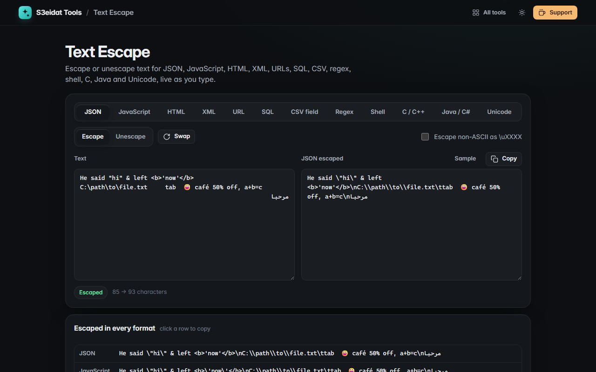

# Text Escape

> Escape and unescape strings for JSON, JavaScript, HTML, XML, URLs, SQL, CSV, regex, shell, C, Java and Unicode. Free, private, and it runs entirely in your browser.

### ▶ [Open Text Escape](https://s3eidat.github.io/text-escape/)



## Features

- **12 formats**, both directions, live as you type:
  - **JSON** string body (optionally `\uXXXX` for non-ASCII)
  - **JavaScript** string (all quote styles, `${`, `\0`, `\xHH`, `\u{…}`, U+2028/2029)
  - **HTML** entities, named and numeric (decodes every HTML5 named entity)
  - **XML** (the five predefined entities and numeric references)
  - **URL** component (`encodeURIComponent`, optionally `+` for spaces)
  - **SQL** single quotes (optionally wrapped, optionally MySQL backslashes)
  - **CSV** field (RFC 4180 quoting, comma, semicolon or tab)
  - **Regex** literal, **shell** single quotes (POSIX)
  - **C / C++** (octal for control bytes, optionally UTF-8 octal for non-ASCII)
  - **Java / C#** (control characters as octal, so `\u000a` can never break a literal)
  - **Unicode** escapes: `\uXXXX`, `\u{X}`, `\UXXXXXXXX`, `&#xX;` or `U+XXXX`
- **Swap** to feed the output back in and flip the direction
- Clear error messages for malformed input (bad `%` sequences, unclosed quotes, broken escapes)
- A table with your text escaped in **every format at once**; click a row to copy
- Built-in self-test: a deliberately nasty string (quotes, backslashes, control characters, emoji, Arabic, U+2028) round-trips through every mode

## Privacy

Your text never leaves your device. There is no server, no account, no analytics.
The page ships with a strict Content-Security-Policy (`connect-src 'self'`), so the browser
itself blocks any attempt to send data anywhere.

## Run it yourself

It's plain HTML, CSS and JavaScript with no build step:

```bash
git clone https://github.com/s3eidat/text-escape
cd text-escape
python -m http.server 8000
```

Then open http://localhost:8000.

## Support

If this saved you time, **[buy me a coffee ☕](https://s3eidat.github.io/coffee/)**. It keeps every tool free.

---

Part of **[S3eidat Tools](https://s3eidat.github.io/)**: 100+ free, private tools that run in your browser. MIT licensed.
